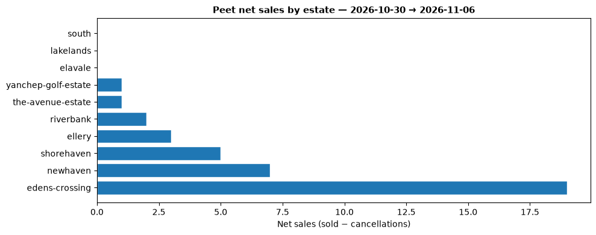
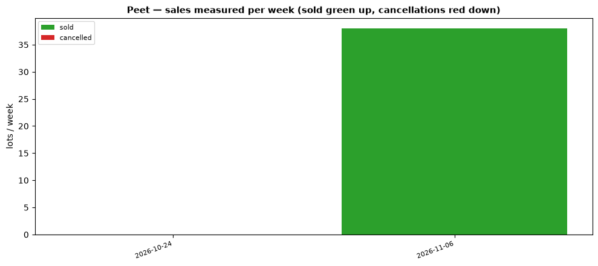

# deData-PPC-Analysis (Peet — GitHub only)

Weekly sales-velocity analysis on top of `deData-PPC-MasterplanDownloader`
snapshots. **No ETL, no database, no website wiring** — snapshot diffs in,
Markdown pack + charts out.

This is the **research** repo for the Peet product. The production path is a
separate chain, documented in
[`docs/ALTERNATIVE-DATA-STANDARD.md`](docs/ALTERNATIVE-DATA-STANDARD.md):

| Layer | Repository |
|---|---|
| Snapshotter | `deData-PPC-MasterplanDownloader` → `gs://masterplans/ppc/masterplans/json/` |
| ETL → Firestore | `deData-PPC-ETL-Pipeline` → `PPC/masterplan-data/communities/{estate}` |
| Product site | `ppc.data.deautomation.co` (planned — [`docs/PPC-GO-LIVE.md`](docs/PPC-GO-LIVE.md)) |
| Identity, Stripe, entitlements | `data.deautomation.co` |

Nothing in this repo feeds production. It exists to work out what the data
means before the pipeline is trusted with it.

---

## Where things stand — 2026-11-06

The weekly job has been landing snapshots all along; this repo just never pulled
them. It does now (`scripts/sync.py`), and the series has its first real number:

| Week ending | Net sales | Sold | Cancelled | Newly listed | Lots tracked |
|---|---:|---:|---:|---:|---:|
| 2026-10-24 | 0 | 0 | 0 | 0 | 6,081 |
| 2026-11-06 | **38** | 38 | 0 | 50 | 6,173 |

35 estates in the bucket's latest run, 6,173 lots, 57% already sold.

## Latest renders

**Net sales by estate — week ending 2026-11-06**



**Velocity to date**



**Estate masterplans — 27 estates, dated versions**


## What Peet publishes per lot

Every community page embeds the full inventory server-side, no auth:

```js
var lotConfig = {"lots_data":[...], "all_lots_with_status":[...], "mapConfig":{...}}
```

- **Every lot** (6,779 across 34 live pages) carries exactly six fields:
  `lot_id, lot_status, lot_number, lot_name, stage_name, lot_post_status`.
- **Published lots only** — 221 of them, ~3% of inventory — add
  `price, size, frontage, bedrooms, bathrooms, garage_spaces, product_type`.
  Prices run $184k–$1.279M, median $490k.
- **No sold lot carries a price.** Sale price, contract date, settlement date and
  buyer are never published. A sale is a *state* (status `7`), so events only
  exist by diffing snapshots — dated to the pull, priced at last-ask.

## Estate masterplans

Peet's lot-selection map is a **vector SVG on the `/for-sale/` page**, not the
marketing page: `…/{Slug}_MP_{DDMMYY}.svg`. The `_MP_DDMMYY` suffix is the map's
own version date.

Captured **27 of 36 estates**, one PNG per estate per version:

```
_peet/masterplans/<estate>/<YYYY-MM-DD>.png     # 23 schematic, 4 aerial
_peet/masterplans/index.csv                     # estate, version_date, map_kind
```

Rendered with headless Chrome (PyMuPDF turns these SVGs into black silhouettes —
their fills live in CSS classes). Two traps, both hit: the megamenu on every page
carries *other* estates' map thumbnails, and some estates' only SVG is a map-pin
marker (`Aston_pin.svg`). Full method and gap list:
[`_peet/masterplans/README.md`](_peet/masterplans/README.md).

## What isn't available

- **Sale prices / dates / buyers.** Not published anywhere on the site. The REST
  layer (`/wp-json/wp/v2/lots`, `/crm-syndication/v1/lots*`) exposes only 6
  syndicated lots.
- **Cadastre.** No lot polygons. `mapConfig.mapCoordinates` is a rough boundary
  ring on just 8 of 34 estates; no `{estate}-capsule` buckets exist. Real
  geometry would need state cadastre or Peet handing over the Runway capsule.
- **The `Peet/` prefix in Runway's `sog-p2` bucket.** Enumerated: 3,651 objects,
  1.37 GB, all 2017–18 marketing artwork. No lot status, no geometry, no join
  key. It is not a data source. See
  [`peet-leak-from-runway.md`](peet-leak-from-runway.md).

## How it works

`scripts/weekly.py` takes the two latest **full** runs (≥20 estates) and diffs
them lot-by-lot on `(community, lot_id)`:

- available/published → status `7`, or silently delisted ⇒ **sale** (last-asked price)
- `7` → back to available ⇒ **cancellation** (negative sale)
- first-seen lots are labelled, never counted as velocity (same rule as SGP)

Outputs per run date: `reports/<date>/WEEKLY.md`, `reports/<date>/weekly.csv`,
`charts/<date>_net_sales.png`, and a row appended to `reports/history.csv`.

## Run it

```bash
pip install matplotlib          # only dependency
gcloud auth login               # once; read access to gs://masterplans
python3 scripts/sync.py         # latest 2 full runs -> ./_in (gunzipped)
python3 scripts/weekly.py --input ./_in
```

`scripts/sync.py` lists the bucket, groups objects into runs by timestamp, keeps
runs with ≥20 estates, pulls the newest `--latest N` (default 2) and decompresses.
`--dry-run` previews, `--include-csv` also fetches the flattened CSVs,
`--backend gcloud|python|auto` picks the transport.

The downloader stores snapshots **gzipped** (`*.json.gz`). A plain
`gcloud storage cp` leaves the suffix on, and the old globbing ignored it — a
"successful" sync produced a directory that made the analysis exit with
`need 2 full runs`. `sync.py` decompresses and `weekly.py` now reads either form.

Synced snapshots are gitignored (`_in/`, `*-ppc-website-masterplan-data-*`).
When testing, redirect both outputs: `--out /tmp/rep --charts /tmp/charts`.

## Status codes

7 ≈ sold · 2 ≈ available · 4 ≈ future · 1/5/3/8 = mid-states. Decode notes live
in the downloader README; this repo consumes codes as-is and lets week-over-week
movement confirm them.

## Spring Mountain anomaly

The `spring-mountain` page serves a leaked aggregate of ~606 lots belonging to
other estates (Forestville, Yanchep, Tonsley…), not its own inventory. The
downloader excludes it from discovery (`EXCLUDE`); if a snapshot does contain it,
`weekly.py` strips it from the diff (`QUARANTINE = {'spring-mountain'}`) and notes
its lot count in `WEEKLY.md`. Full detail in [AGENTS.md](./AGENTS.md).

## Vanished estates (delisting ≠ sale)

An estate removed from both the index and robots sitemaps is simply absent from
that run — not carried forward. `weekly.py` iterates the current run's lots and
looks each up in the previous one, so a vanished estate's lots are never counted
as sold; it prints a `Gone:` line instead. Runs with <20 estates are not "full"
and are never used as a diff endpoint.

## Repo boundary

`deData-PPC-MasterplanDownloader` is the snapshotter — read-only from here, never
edited in this project. All analysis work lives here: `scripts/`, `reports/`,
`charts/`, and `_peet/` for research captures. If a fix is needed upstream, note
it; don't touch the downloader checkout.

## Cadence

Run after each weekly snapshot lands. Reports accumulate in `reports/`, charts in
`charts/`. Nothing here ever touches Firestore or the website.
