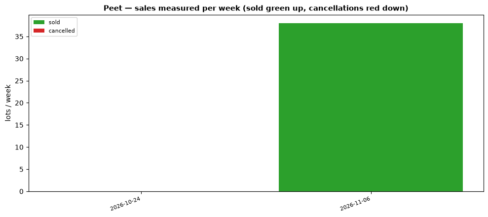

# PPC weekly — 2026-10-30 → 2026-11-06

*Most recent data: 2026-11-06 (snapshots 2026-10-30_07-00 → 2026-11-06_07-00).*

Snapshots: 6,168 → 6,173 lots tracked.
**Net sales: 38** (38 sold, 0 cancellations), 50 newly listed.

## Per-estate

- **edens-crossing**: net 19 (sold 19, cancelled 0, newly listed 0)
- **newhaven**: net 7 (sold 7, cancelled 0, newly listed 0)
- **shorehaven**: net 5 (sold 5, cancelled 0, newly listed 2)
- **ellery**: net 3 (sold 3, cancelled 0, newly listed 0)
- **riverbank**: net 2 (sold 2, cancelled 0, newly listed 0)
- **the-avenue-estate**: net 1 (sold 1, cancelled 0, newly listed 1)
- **yanchep-golf-estate**: net 1 (sold 1, cancelled 0, newly listed 18)
- **elavale**: net 0 (sold 0, cancelled 0, newly listed 10)
- **lakelands**: net 0 (sold 0, cancelled 0, newly listed 1)
- **south**: net 0 (sold 0, cancelled 0, newly listed 18)

## Estate changes
New: the-landing-strathpine
Gone: —

_First-seen lots excluded from velocity. Method mirrors SGP persistent tracking._
